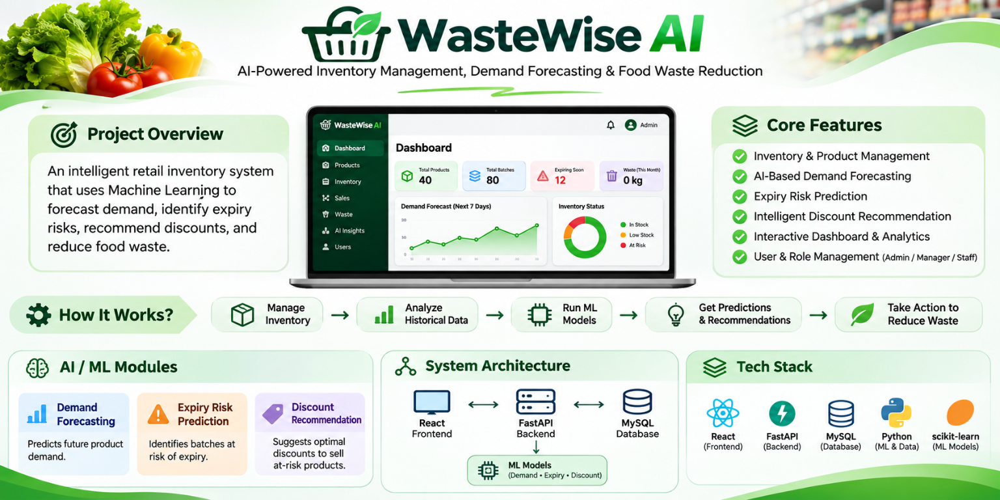

# WasteWise AI

WasteWise AI is a web-based inventory and food-waste management application for perishable products. It combines store operations, expiry-risk monitoring, demand forecasting, and model-backed recommendations through a React frontend, FastAPI backend, and MySQL database.

<p align="center">
  
</p>

<p align="center"><em>Project overview illustration. Dashboard values and mock interface elements are illustrative, not live application data.</em></p>

## Project Overview

The application is designed for a single-store workflow. Protected API operations use signed bearer-token sessions and the configured MySQL database.

## How to Use WasteWise AI

This section describes a typical workflow for a store team using the implemented application. Available pages and actions depend on the signed-in user's role and on the database schema being up to date.

1. **Sign in and review the dashboard.** Start the backend and frontend, sign in with an authorized account, and use the Dashboard to review current sales, inventory, and operational summaries loaded from the API.
2. **Set up products and inventory.** In Products and Inventory, review existing catalog and stock information or add products. In Batch Management, create or update batches with received quantities and expiry dates. Batch CSV import is available to authorized administrators through its preview and confirmation workflow.
3. **Monitor expiry risk.** Open Expiry Alerts to search batches and filter by category, risk, location, or supplier. Review batch details and suggested actions, then make any stock decision explicitly. Alert suggestions do not change inventory by themselves.
4. **Process sales.** Use Sales / POS to select products and submit checkout. The backend validates and records the checkout; Sales History displays persisted sales data.
5. **Record waste.** In Waste Reports, record a waste event against the appropriate batch. This is a write operation and may decrease that batch's remaining quantity.
6. **Review demand forecasts.** Demand Forecast initially displays saved forecast records. Select the explicit generation action when a new forecast is needed; generation writes forecast records. Merely opening or refreshing the page does not generate forecasts.
7. **Evaluate recommendations.** Review discount, reorder, and expiry-related recommendations. Apply, dismiss, or otherwise act only through the available explicit controls and permissions. Viewing a suggestion does not automatically discount, restock, or discard a product.
8. **Review model information.** Model Metrics and Model Registry expose available model and prediction data. Feature-importance results depend on the model artifact. Model evaluation or retraining is an explicit, permission-gated operation and is not triggered by viewing the page.
9. **Manage preferences and administration.** Settings provides available general, store, notification, and appearance options. Notification preference persistence requires the `user_notification_settings` schema migration. Authorized administrators can also use supported exports, database backup/restore, and user-management tools; database restore replaces live records and must be treated as a destructive operation.

This workflow uses live API and database functionality; it is not a demo flow with simulated success. Some functions require an approved migration or role permission, and unavailable features should not be treated as completed operations.

## Table of Contents

- [Project Overview](#project-overview)
- [How to Use WasteWise AI](#how-to-use-wastewise-ai)
- [Key Features](#key-features)
- [Technology Stack](#technology-stack)
- [Prerequisites](#prerequisites)
- [Project Structure](#project-structure)
- [Windows Installation and Launch](#windows-installation-and-launch)
  - [1. MySQL Configuration](#1-mysql-configuration)
  - [2. Backend Environment Configuration](#2-backend-environment-configuration)
  - [3. Python Virtual Environment Setup](#3-python-virtual-environment-setup)
  - [4. Backend Installation and Startup](#4-backend-installation-and-startup)
  - [5. Frontend Installation and Startup](#5-frontend-installation-and-startup)
- [Database and Migration Notes](#database-and-migration-notes)
  - [Expiry Provenance and Shelf-Life Settings Migration](#expiry-provenance-and-shelf-life-settings-migration)
  - [User Notification Settings Migration](#user-notification-settings-migration)
- [Frontend API Integration](#frontend-api-integration)
- [Application Behaviour and Data Limitations](#application-behaviour-and-data-limitations)
- [Expiry Alerts](#expiry-alerts)
- [Product Image Uploads](#product-image-uploads)
- [Verification and Testing](#verification-and-testing)
- [API Health Checks](#api-health-checks)
- [Security Notes](#security-notes)
- [Troubleshooting](#troubleshooting)
- [License](#license)
- [Maintainers](#maintainers)

## Key Features

- Dashboard summaries backed by operational API data.
- Product, inventory, and batch management, including batch expiry details.
- Point-of-sale checkout and sales-history views.
- Waste recording and reporting.
- Expiry alerts with filters, summaries, batch detail, and exports.
- Saved demand forecasts and discount/reorder recommendations.
- Model metrics, model registry, and model-dependent feature-importance views.
- User notification preferences and notification center.
- CSV import and data exports for supported datasets, subject to role and endpoint permissions.
- Database backup and restore workflows for authorized administrators.
- Product image uploads from the Edit Batch form.

## Technology Stack

| Layer | Technology |
| --- | --- |
| Frontend | React, Vite, TypeScript, Node.js, npm |
| Backend | Python 3.14, FastAPI, Uvicorn |
| Database | MySQL 8.0 |
| Authentication | Signed bearer-token sessions |
| ML artifacts | Joblib model artifacts |

| Service | Default address |
| --- | --- |
| Frontend development server | `http://localhost:5173` |
| Backend API | `http://127.0.0.1:8001` |
| API documentation | `http://127.0.0.1:8001/docs` |
| API health | `http://127.0.0.1:8001/health` |
| Database health | `http://127.0.0.1:8001/health/database` |
| MySQL | `127.0.0.1:3306` |

## Prerequisites

Install or confirm the following on Windows:

- Windows PowerShell.
- Python 3.14.
- Node.js and npm.
- MySQL Server 8.0, with the `MySQL80` service available.
- An existing, provisioned `wastewise_ai` database and an application database account.
- An authorized DBA/schema-migration account for any approved schema changes.

> **Database safety:** The existing database must not be recreated. Do not run `backend\init.sql` against it.

## Project Structure

```text
WasteWise-AI/
├── backend/
│   ├── app/                 # FastAPI application, APIs, services, models
│   ├── migrations/          # Reviewed SQL migrations and runbooks
│   ├── tests/               # Backend tests
│   ├── uploads/             # Uploaded product/store images (local data)
│   ├── .env.example         # Environment-variable template
│   └── requirements.txt
├── database/
│   ├── migrations/
│   ├── schema.sql
│   └── seed_data.sql
├── docs/                    # API, database, model, and project documentation
├── frontend/
│   ├── src/                 # React application
│   ├── public/
│   ├── package.json
│   └── package-lock.json
├── ml/
│   ├── artifacts/           # Model artifacts and metrics
│   ├── data/
│   ├── notebooks/
│   └── tests/
├── scripts/
├── tests/
├── docker-compose.yml
└── README.md
```

Local environment files, virtual environments, installed packages, and generated uploads are not source-code setup requirements and should not be committed.

## Windows Installation and Launch

Run the setup commands from PowerShell at the repository root unless a step says otherwise. Use two PowerShell terminals: keep the backend running in one and start the frontend in the other.

### 1. MySQL Configuration

Check that MySQL is running and accepting connections:

```powershell
Get-Service MySQL80
Test-NetConnection 127.0.0.1 -Port 3306
```

If the service is stopped, open an elevated PowerShell terminal and start it:

```powershell
Start-Service MySQL80
```

The application database name is `wastewise_ai`. Use an existing database; do not create or recreate it as part of this setup.

### 2. Backend Environment Configuration

Create `backend\.env` from the template only if the local file does not already exist. Then edit it with the values for your environment:

```powershell
if (-not (Test-Path backend\.env)) { Copy-Item backend\.env.example backend\.env }
```

The file must define these variables:

```dotenv
DB_HOST=127.0.0.1
DB_PORT=3306
DB_NAME=wastewise_ai
DB_USER=your_restricted_application_user
DB_PASSWORD=replace_with_your_local_secret
AUTH_SECRET_KEY=replace_with_a_private_secret_of_at_least_32_characters
```

`AUTH_SECRET_KEY` must be a private value of at least 32 characters. Replace all placeholder values with local configuration. Never commit `backend\.env` or share its contents.

### 3. Python Virtual Environment Setup

From the repository root:

```powershell
py -3.14 -m venv .venv314
.\.venv314\Scripts\Activate.ps1
```

If PowerShell blocks activation, follow your machine's approved execution-policy procedure; do not weaken system security settings unnecessarily.

### 4. Backend Installation and Startup

Install the backend dependencies:

```powershell
python -m pip install --upgrade pip
python -m pip install -r backend\requirements.txt
```

Move into the backend directory, validate the required settings, and check database connectivity:

```powershell
Set-Location backend
python -c "from app.core.config import get_database_settings, get_auth_secret; get_database_settings(); get_auth_secret(); print('Backend configuration is valid.')"
python -m app.db.init_db
```

`app.db.init_db` only verifies the database connection with `SELECT 1`. It does **not** create, reset, or migrate database tables.

Start FastAPI:

```powershell
python -m uvicorn app.main:app --host 127.0.0.1 --port 8001 --reload
```

The API is available at `http://127.0.0.1:8001`; interactive API documentation is at `/docs`.

### 5. Frontend Installation and Startup

Open a second PowerShell terminal at the repository root:

```powershell
Set-Location frontend
npm ci
npm.cmd run dev -- --host 127.0.0.1
```

Open `http://localhost:5173`. In development, Vite forwards `/api` requests to `http://127.0.0.1:8001` by default.

## Database and Migration Notes

### Existing database safety

The existing `wastewise_ai` database is not a disposable development database. Do not:

- Recreate the database.
- Run `backend\init.sql` against the existing database.
- Assume a migration has been applied merely because its SQL file exists.
- Run schema changes with the restricted application database account.

Before any schema change, review the exact migration and its effects, confirm the selected database and current schema using read-only metadata queries, and take an approved, recoverable backup. Apply migrations only with an authorized DBA/schema-migration account. Stop if schema state is unexpected or only partially matches a migration; have the DBA investigate rather than rerunning or improvising DDL.

The migration commands below are provided for authorized operators after review, backup, and preflight checks. They do not authorize changes to an unapproved database.

### Expiry Provenance and Shelf-Life Settings Migration

Migration file: `backend\migrations\20261105_add_expiry_provenance_and_shelf_life_settings.sql`

This migration adds `inventory_batches.expiry_date_source` and creates `category_shelf_life_settings`. Batch reads and edits can work with the legacy schema, but expiry-date provenance and category shelf-life settings require the corresponding schema objects.

Before applying it, connect to the intended `wastewise_ai` schema with an authorized account and inspect the target objects. These read-only queries use `INFORMATION_SCHEMA`:

```sql
SELECT TABLE_NAME
FROM INFORMATION_SCHEMA.TABLES
WHERE TABLE_SCHEMA = DATABASE()
  AND TABLE_NAME IN ('inventory_batches', 'category_shelf_life_settings');

SELECT COLUMN_NAME
FROM INFORMATION_SCHEMA.COLUMNS
WHERE TABLE_SCHEMA = DATABASE()
  AND TABLE_NAME = 'inventory_batches'
  AND COLUMN_NAME = 'expiry_date_source';
```

Confirm that `inventory_batches` exists and that the target column and table are absent before applying the migration. If either target already exists, or the database is in a partial state, stop and have the DBA compare the actual definitions with the migration. The `ALTER TABLE` and `CREATE TABLE` statements are not safe to rerun.

After review, approved backup, and preflight, an authorized DBA/schema-migration account can apply the migration once. Replace `YOUR_DBA_USER` with the approved account name:

```powershell
& $env:ComSpec /c '""C:\Program Files\MySQL\MySQL Server 8.0\bin\mysql.exe" -h 127.0.0.1 -P 3306 -u YOUR_DBA_USER -p wastewise_ai < "backend\migrations\20261105_add_expiry_provenance_and_shelf_life_settings.sql"'
```

### User Notification Settings Migration

Migration file: `backend\migrations\20261106_add_user_notification_settings.sql`

Notification preferences are stored per authenticated user in `user_notification_settings`. The migration creates the schema needed to store those preferences; application writes create or update a user's settings row.

Before applying it, confirm that the table is absent from the intended schema:

```sql
SELECT TABLE_NAME
FROM INFORMATION_SCHEMA.TABLES
WHERE TABLE_SCHEMA = DATABASE()
  AND TABLE_NAME = 'user_notification_settings';
```

If the table exists, inspect and compare its full definition with the migration; do not rerun the non-idempotent `CREATE TABLE` statement. If it is absent, apply only after migration review and an approved backup. Replace `YOUR_DBA_USER` with the approved DBA/schema-migration account:

```powershell
& $env:ComSpec /c '""C:\Program Files\MySQL\MySQL Server 8.0\bin\mysql.exe" -h 127.0.0.1 -P 3306 -u YOUR_DBA_USER -p wastewise_ai < "backend\migrations\20261106_add_user_notification_settings.sql"'
```

The restricted application database account cannot create tables and must not be used for schema modifications. The repository contains other migration files as well; review each migration and its prerequisites separately rather than assuming these two files represent every possible schema change.

## Frontend API Integration

In development, the frontend makes same-origin `/api` requests through the Vite proxy. Its default target is `http://127.0.0.1:8001`. To set a different development target, configure `VITE_API_PROXY_TARGET` in the frontend environment:

```dotenv
VITE_API_PROXY_TARGET=http://127.0.0.1:8001
```

When hosting the frontend and backend separately, configure the backend origin with `VITE_API_BASE_URL`:

```dotenv
VITE_API_BASE_URL=http://127.0.0.1:8001
```

Also allow the frontend origin in the backend's `FRONTEND_ORIGINS` setting. Protected API requests use the signed-in user's bearer token. Expired or revoked sessions require the user to sign in again.

## Application Behaviour and Data Limitations

| Area | Current behaviour |
| --- | --- |
| Dashboard | Reads operational summaries from the backend API. |
| Inventory management | Reads and manages products and inventory data through the API. Supported data exports are limited to records returned by their API endpoints. |
| Batch management | Supports batch creation and updates, including expiry details. Batch CSV import has a preview/confirmation workflow. Persisting expiry-date provenance requires its migration. |
| Sales history | Displays sales records read from the backend. |
| POS checkout | Uses the server-authoritative `POST /api/v1/sales/checkout` API. Checkout is not simulated in the browser. |
| Waste management | Recording waste is an explicit write operation and can reduce the selected batch's remaining quantity. |
| Expiry alerts | Reads positive-quantity batches and provides risk classifications, filters, summaries, details, and exports; see [Expiry Alerts](#expiry-alerts). |
| Demand forecasting | Opening the page reads saved forecasts. Generating forecasts is an explicit write operation because it persists forecast records. |
| Discount and stock recommendations | Combines available inventory, forecast, expiry-risk, and recommendation data. Reviewing a suggestion does not automatically change stock, apply a discount, or discard a batch; any supported action must be explicitly selected. |
| Model metrics | Shows model and prediction metrics from available API data. Model evaluation/retraining operations are permission-gated. |
| Model registry | Reads registry information from the API; model artifact availability affects which details and operations are available. |
| Feature importance | An API and UI are present. Results depend on the selected model artifact and its support for importance data; some models can report that it is unavailable. |
| Notification settings | Stores per-user notification preferences when the required database schema is available. Apply the notification settings migration before relying on persisted preferences in a legacy schema. |
| CSV import | Admin-only CSV import is implemented for supported products, inventory, and sales datasets. The endpoint validates input and reports failures; not every dataset or arbitrary CSV shape is importable. |
| Database backups | Admin-only database backup creation, upload, download, and restore endpoints are implemented. Restore replaces live database records and requires explicit confirmation. |
| Settings backup restore | A separate settings-only backup/restore workflow is not provided. This is distinct from the database backup/restore feature. |
| General and store settings | General settings are stored per user and store information has backend settings endpoints. Actual persistence depends on the relevant tables being present in the deployed schema. |

Model retraining is an explicit, admin-only operation with confirmation; it is not automatic. Availability and successful outcomes depend on required data, compatible artifacts, and the deployment's database schema.

## Expiry Alerts

Expiry Alerts reads positive-quantity batches from `inventory_batches`, joined to `products`. Risk bands are calculated from each batch's stored expiry date:

| Risk category | Days remaining |
| --- | --- |
| Expired | Less than 0 |
| High | 0–3 |
| Medium | 4–7 |
| Low | 8–14 |
| Safe | More than 14 |

The `/api/v1/expiry-alerts` endpoint supports:

- Search across product, SKU, category, batch, location, and supplier information.
- Category, risk, location, and supplier filters.
- Pagination.
- Chart summaries.
- Batch details and suggested actions.
- CSV and XLSX exports.

Suggested actions are advisory; reviewing an expiry suggestion does not itself update inventory or execute the suggested action. Alert-rule changes are recorded as append-only events in `user_activity`. Only administrators and store managers can manage alert rules.

## Product Image Uploads

Product images can be uploaded from the **Edit Batch** form.

- API-server upload directory: `backend\uploads\products`
- Uploaded product images are displayed in **Sales / POS**; other pages may continue to use product symbols.
- Include `backend\uploads\products` in backups if those images must survive a server move or restore.

## Verification and Testing

Run backend tests from the repository root with the project virtual environment activated:

```powershell
python -m pytest backend\tests
```

Run frontend tests and a production build from the `frontend` directory:

```powershell
npm.cmd test
npm.cmd run build
```

Backend tests use isolated test databases. Tests are not authorization to modify a live database or apply migrations.

## API Health Checks

With the backend and frontend running, execute these checks in PowerShell:

```powershell
curl.exe -f http://127.0.0.1:8001/health
curl.exe -f http://127.0.0.1:8001/health/database
curl.exe -i http://127.0.0.1:5173/api/v1/auth/me
```

The first endpoint checks that the API is responding. The second verifies database connectivity. The final request verifies that Vite forwards `/api` to FastAPI; without a bearer token, `/api/v1/auth/me` should return **HTTP 401**, which is expected for an unauthenticated request.

## Security Notes

- Never commit `backend\.env` or expose database credentials, tokens, or signing secrets.
- Keep `AUTH_SECRET_KEY` private and at least 32 characters long.
- Use a restricted application database account for normal API operation.
- Use an authorized DBA/schema-migration account only for reviewed schema changes.
- Confirm the target database and inspect `INFORMATION_SCHEMA` before migration.
- Take an approved backup before schema changes; do not rerun non-idempotent migrations.
- Treat database restore as a destructive operation that replaces live records; use only with authorization and explicit confirmation.
- Protect uploaded product images and include them in backup/restore procedures when required.

## Troubleshooting

| Symptom | Checks |
| --- | --- |
| MySQL connection fails | Confirm `MySQL80` is running and port `3306` is reachable with `Test-NetConnection`. |
| Backend configuration validation fails | Check required keys in `backend\.env`; confirm the auth secret is private and at least 32 characters. |
| Database health check fails | Verify `DB_HOST`, `DB_PORT`, `DB_NAME`, application-user permissions, and MySQL availability. |
| Frontend API requests fail | Confirm FastAPI is running on port `8001` and check `VITE_API_PROXY_TARGET`. |
| Protected endpoint returns HTTP 401 | Sign in and ensure the request includes a valid bearer token. A 401 from `/api/v1/auth/me` without a token is expected. |
| Expiry provenance is unavailable | Check that the migration was reviewed and applied, and verify `inventory_batches.expiry_date_source` in `INFORMATION_SCHEMA`. |
| Notification preferences are unavailable | Check that `user_notification_settings` exists and matches the approved migration schema. |
| Product images are missing after restore | Restore `backend\uploads\products` along with the database and application files, if those images were included in the backup plan. |
| Migration target already exists | Do not rerun the migration. Have an authorized DBA inspect and compare the existing schema with the migration file. |

## License

Add the project's chosen license and copyright details here before public distribution. No license is specified in this repository documentation.

## Maintainers

Add the project maintainer or team contact details here. Maintainer details have not been specified.
